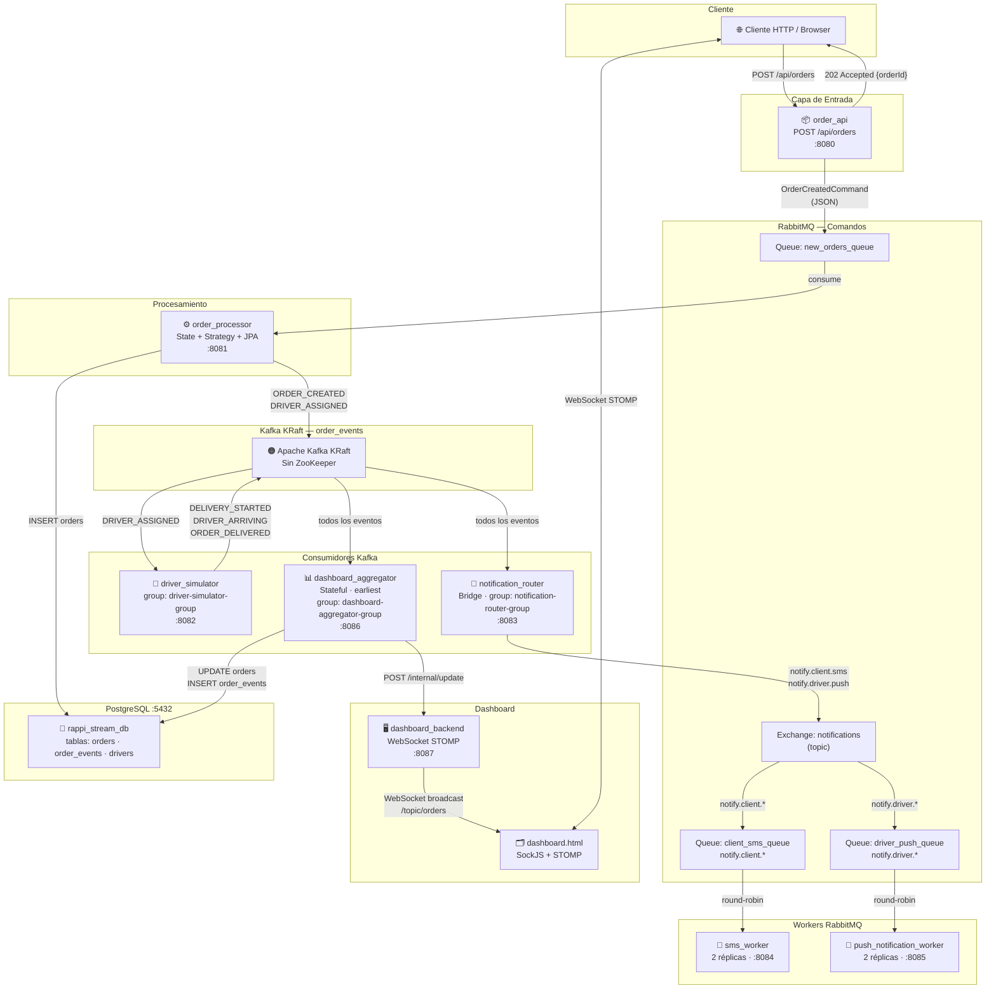

# Diagrama de Arquitectura — Rappi-Stream



## Notas de Arquitectura

### Patrón de flujo: Comando → Evento → Comando + Persistencia

1. **RabbitMQ como canal de comandos**: `order_api` publica `OrderCreatedCommand` en `new_orders_queue`. Es un comando porque representa una intención: "quiero crear este pedido". RabbitMQ es ideal aquí por su modelo Work Queue (garantía de entrega a exactamente un consumidor).

2. **Kafka como log de eventos inmutable**: una vez que `order_processor` acepta y procesa el comando, publica eventos inmutables en Kafka. Estos eventos son hechos ocurridos, no intenciones.

3. **Tres consumidores independientes del mismo log**: `driver_simulator`, `notification_router` y `dashboard_aggregator` tienen group IDs distintos, por lo que cada uno recibe una copia de cada evento. Kafka garantiza el orden dentro de cada partición (por `order_id`).

4. **RabbitMQ como canal de notificaciones**: `notification_router` traduce eventos Kafka en comandos de notificación y los enruta por tipo usando Topic Exchange.
```
