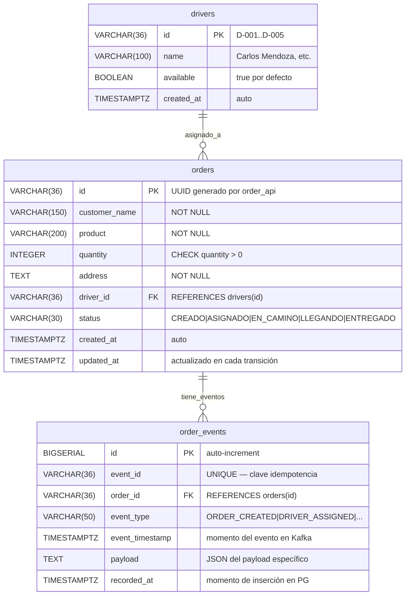

# Diagrama de Base de Datos — PostgreSQL rappi_stream_db



## Decisiones de diseño

### Por qué `event_id` es UNIQUE en `order_events`

El `dashboard_aggregator` está configurado con `auto.offset.reset=earliest`. Esto significa que al arrancar por primera vez (sin offset guardado), reprocesa **todos** los eventos históricos del topic de Kafka. Sin la constraint UNIQUE, insertaría filas duplicadas en cada reinicio.

La constraint actúa como segunda barrera de idempotencia:
1. Primera barrera: `existsByEventId()` antes de procesar → evita trabajo innecesario
2. Segunda barrera: `UNIQUE constraint` en la BD → evita duplicados si dos hilos procesan el mismo evento simultáneamente

### Por qué `driver_id` es nullable en `orders`

El pedido se crea en estado `CREADO` antes de tener un repartidor asignado. `order_processor` primero hace el INSERT con `driver_id = NULL`, luego aplica la Strategy y hace el UPDATE con el driver. Esto refleja fielmente la secuencia del negocio.

### Separación entre `order_processor` y `dashboard_aggregator`

Ambos escriben en PostgreSQL pero con responsabilidades distintas:
- `order_processor`: INSERT inicial + UPDATE a ASIGNADO (dentro del flujo de procesamiento del comando)
- `dashboard_aggregator`: actualiza el status en cada evento Kafka subsiguiente (EN_CAMINO, LLEGANDO, ENTREGADO)

No hay conflicto porque trabajan en fases temporales diferentes.

### Índices creados por `init.sql`

```sql
-- Consultar el historial de eventos de un pedido específico
CREATE INDEX idx_order_events_order_id ON order_events(order_id);

-- Filtrar eventos por tipo (para análisis y dashboard)
CREATE INDEX idx_order_events_event_type ON order_events(event_type);
```
