# Diagrama de Clases — Dominio y Patrones

```mermaid
classDiagram

    %% ==========================================
    %% PATRÓN STATE — Ciclo de vida del Pedido
    %% ==========================================

    class OrderState {
        <<interface>>
        +asignarRepartidor(pedido, driverId, driverName)
        +iniciarEntrega(pedido)
        +registrarLlegada(pedido)
        +completarEntrega(pedido)
        +nombre() String
    }

    class EstadoCreado {
        +asignarRepartidor(pedido, driverId, driverName) ✅
        +iniciarEntrega(pedido) ❌ IllegalStateException
        +registrarLlegada(pedido) ❌ IllegalStateException
        +completarEntrega(pedido) ❌ IllegalStateException
        +nombre() "CREADO"
    }

    class EstadoAsignado {
        +asignarRepartidor(pedido, driverId, driverName) ❌
        +iniciarEntrega(pedido) ✅
        +registrarLlegada(pedido) ❌ IllegalStateException
        +completarEntrega(pedido) ❌ IllegalStateException
        +nombre() "ASIGNADO"
    }

    class EstadoEnCamino {
        +asignarRepartidor(pedido, driverId, driverName) ❌
        +iniciarEntrega(pedido) ❌ IllegalStateException
        +registrarLlegada(pedido) ✅
        +completarEntrega(pedido) ❌ IllegalStateException
        +nombre() "EN_CAMINO"
    }

    class EstadoLlegando {
        +asignarRepartidor(pedido, driverId, driverName) ❌
        +iniciarEntrega(pedido) ❌ IllegalStateException
        +registrarLlegada(pedido) ❌ IllegalStateException
        +completarEntrega(pedido) ✅
        +nombre() "LLEGANDO"
    }

    class EstadoEntregado {
        +asignarRepartidor(pedido, driverId, driverName) ❌
        +iniciarEntrega(pedido) ❌ IllegalStateException
        +registrarLlegada(pedido) ❌ IllegalStateException
        +completarEntrega(pedido) ❌ IllegalStateException
        +nombre() "ENTREGADO"
    }

    OrderState <|.. EstadoCreado
    OrderState <|.. EstadoAsignado
    OrderState <|.. EstadoEnCamino
    OrderState <|.. EstadoLlegando
    OrderState <|.. EstadoEntregado

    %% ==========================================
    %% ENTIDAD RICA — Pedido
    %% ==========================================

    class Pedido {
        -String id
        -String customerName
        -String product
        -int quantity
        -String address
        -String driverId
        -String driverName
        -Instant creadoEn
        -Instant actualizadoEn
        -OrderState estadoActual
        +Pedido(id, customerName, product, quantity, address)
        +asignarRepartidor(driverId, driverName) void
        +iniciarEntrega() void
        +registrarLlegada() void
        +completarEntrega() void
        +getNombreEstado() String
        +getId() String
        +getDriverId() String
    }

    Pedido --> OrderState : delega a estadoActual

    %% ==========================================
    %% PATRÓN STRATEGY — Asignación de repartidores
    %% ==========================================

    class DriverAssignmentStrategy {
        <<interface>>
        +asignar(pedido) void
    }

    class RoundRobinAssignmentStrategy {
        -List~Driver~ repartidores
        -AtomicInteger cursor
        +RoundRobinAssignmentStrategy(repartidores)
        +asignar(pedido) void
    }

    DriverAssignmentStrategy <|.. RoundRobinAssignmentStrategy
    RoundRobinAssignmentStrategy --> Pedido : llama asignarRepartidor()

    %% ==========================================
    %% PATRÓN STRATEGY — Notificaciones
    %% ==========================================

    class NotificationStrategy {
        <<interface>>
        +aplica(eventType) boolean
        +construir(envelope) Optional~NotificationCommand~
    }

    class DriverArrivingSmsStrategy {
        +aplica(DRIVER_ARRIVING) true
        +construir(envelope) NotificationCommand SMS
    }

    class OrderDeliveredPushStrategy {
        +aplica(ORDER_DELIVERED) true
        +construir(envelope) NotificationCommand PUSH
    }

    NotificationStrategy <|.. DriverArrivingSmsStrategy
    NotificationStrategy <|.. OrderDeliveredPushStrategy

    %% ==========================================
    %% PUERTOS DIP
    %% ==========================================

    class OrderEventPublisherPort {
        <<interface>>
        +publicarOrderCreated(pedido) void
        +publicarDriverAssigned(pedido) void
    }

    class OrderRepositoryPort {
        <<interface>>
        +guardar(pedido) void
        +actualizar(pedido) void
        +buscarPorId(orderId) Optional~Pedido~
        +obtenerRepartidoresDisponibles() List~Driver~
    }

    class KafkaOrderEventPublisher {
        -KafkaTemplate kafkaTemplate
        -ObjectMapper objectMapper
        +publicarOrderCreated(pedido) void
        +publicarDriverAssigned(pedido) void
    }

    class JpaOrderRepositoryAdapter {
        -SpringDataPedidoRepository
        -SpringDataDriverRepository
        +guardar(pedido) void
        +actualizar(pedido) void
    }

    OrderEventPublisherPort <|.. KafkaOrderEventPublisher
    OrderRepositoryPort <|.. JpaOrderRepositoryAdapter

    %% ==========================================
    %% SERVICIO DE APLICACIÓN
    %% ==========================================

    class OrderProcessorService {
        -OrderRepositoryPort repositorio
        -OrderEventPublisherPort publicador
        -DriverAssignmentStrategy estrategia
        +procesarComando(OrderCreatedCommand) void
    }

    OrderProcessorService --> OrderRepositoryPort
    OrderProcessorService --> OrderEventPublisherPort
    OrderProcessorService --> DriverAssignmentStrategy
    OrderProcessorService --> Pedido : crea y manipula

    %% ==========================================
    %% CONTRATOS INMUTABLES (Records Java 17)
    %% ==========================================

    class OrderCreatedCommand {
        <<record>>
        +String commandId
        +String orderId
        +String customerName
        +String product
        +int quantity
        +String address
        +Instant issuedAt
    }

    class OrderEventEnvelope {
        <<record>>
        +String eventId
        +String orderId
        +OrderEventType eventType
        +Instant timestamp
        +String payload
    }

    class NotificationCommand {
        <<record>>
        +String notificationId
        +String orderId
        +String recipientId
        +NotificationType type
        +String message
        +Instant issuedAt
    }
```

## Principios demostrados en el diagrama

| Principio | Dónde se ve |
|-----------|-------------|
| **SRP** | `OrderProcessorService` solo orquesta; `Pedido` solo gestiona estado de negocio |
| **OCP** | Nuevos estados o estrategias → nueva clase, sin tocar las existentes |
| **LSP** | Cualquier `OrderState` puede reemplazar a otro sin romper `Pedido` |
| **ISP** | `OrderEventPublisherPort` y `OrderRepositoryPort` son interfaces mínimas |
| **DIP** | `OrderProcessorService` depende de interfaces, no de `KafkaTemplate` ni `JpaRepository` |
