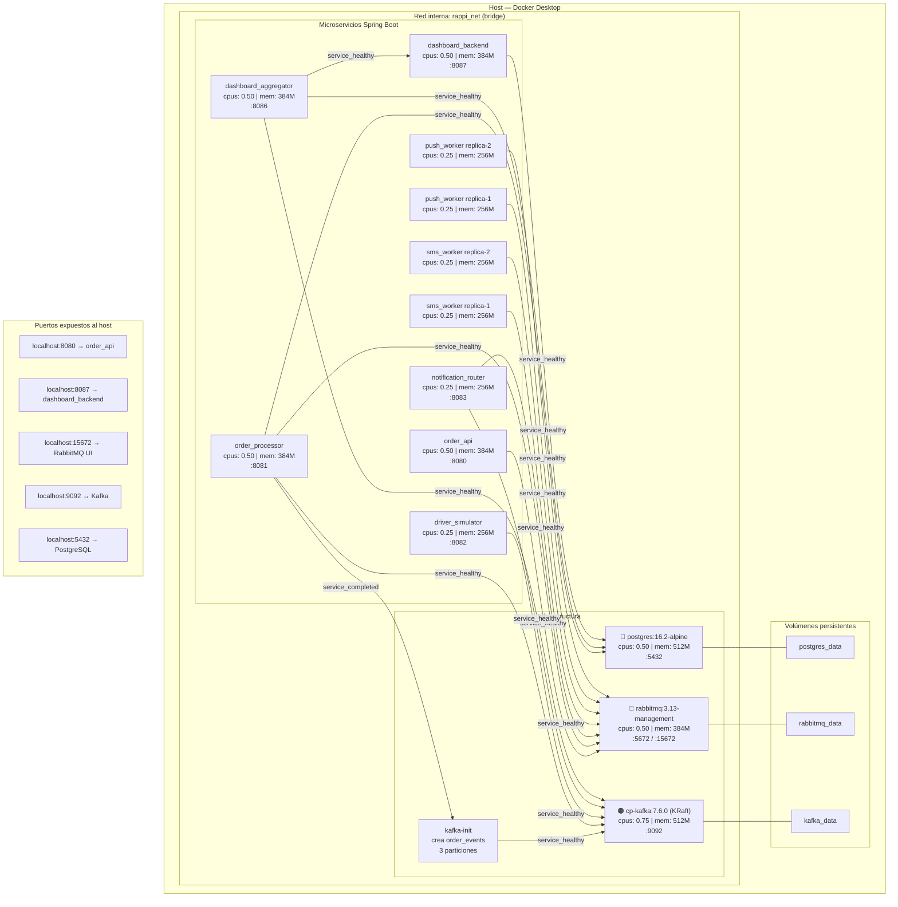

# Diagrama de Deployment — Docker Compose



## Consumo total de recursos estimado

| Servicio | CPU máx | RAM máx |
|----------|---------|---------|
| postgres | 0.50 | 512M |
| rabbitmq | 0.50 | 384M |
| kafka | 0.75 | 512M |
| order_api | 0.50 | 384M |
| order_processor | 0.50 | 384M |
| driver_simulator | 0.25 | 256M |
| notification_router | 0.25 | 256M |
| sms_worker × 2 | 0.50 | 512M |
| push_worker × 2 | 0.50 | 512M |
| dashboard_aggregator | 0.50 | 384M |
| dashboard_backend | 0.50 | 384M |
| **TOTAL** | **~5.25 cores** | **~4.5 GB** |

> Se recomienda al menos **6 GB de RAM** asignados a Docker Desktop y un procesador de 4 núcleos o más.

## Comandos de verificación de recursos en vivo

```bash
# Ver todos los contenedores y sus límites
docker stats --no-stream

# Ver solo los workers escalados
docker compose ps sms_worker
docker compose ps push_notification_worker

# Verificar Kafka KRaft (sin ZooKeeper)
docker compose ps | grep -v zookeeper   # no debe aparecer ningún zookeeper

# Inspeccionar límites de un contenedor específico
docker inspect rappi_order_api --format '{{.HostConfig.Memory}} {{.HostConfig.NanoCpus}}'
```
