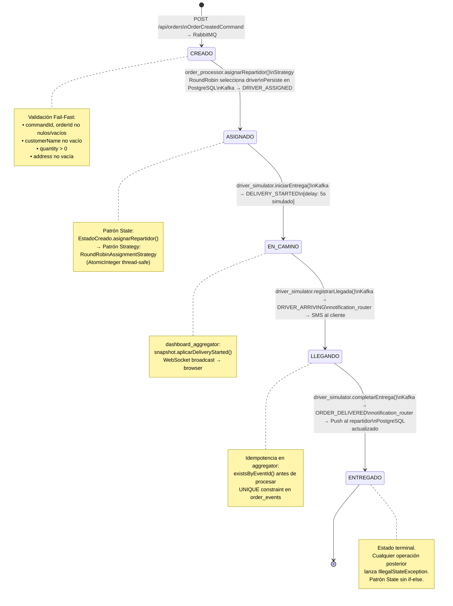

# Diagrama de Estados — Ciclo de Vida del Pedido



## Reglas de Transición — Implementación sin if-else

Cada estado concreto implementa `OrderState` y solo permite su transición válida:

```
EstadoCreado    → permite: asignarRepartidor()   rechaza: iniciarEntrega, registrarLlegada, completarEntrega
EstadoAsignado  → permite: iniciarEntrega()       rechaza: asignarRepartidor, registrarLlegada, completarEntrega
EstadoEnCamino  → permite: registrarLlegada()     rechaza: asignarRepartidor, iniciarEntrega, completarEntrega
EstadoLlegando  → permite: completarEntrega()     rechaza: todo lo demás
EstadoEntregado → rechaza: TODO (estado terminal)
```

La entidad `Pedido` **nunca** evalúa el estado actual con un `if` o `switch`.
Llama directamente `estadoActual.asignarRepartidor(this, driverId, driverName)` y el estado
concreto decide si lanza `IllegalStateException` o ejecuta la transición.
