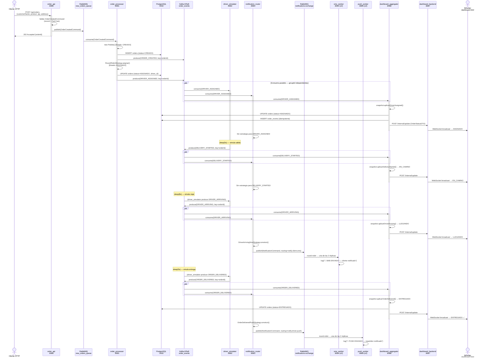

# Diagrama de Secuencia — Flujo Completo End-to-End

## Garantías del sistema en este flujo

| Garantía | Mecanismo |
|----------|-----------|
| Orden de eventos por pedido | `order_id` como clave de partición en Kafka |
| Sin duplicados en PostgreSQL | `event_id` UNIQUE en `order_events` |
| Balanceo de carga en notificaciones | 2 réplicas de cada worker + RabbitMQ Work Queue |
| Resiliencia del dashboard | WebSocket reconecta automáticamente cada 5s |
| Estado reconstruible | `dashboard_aggregator` reprocesa desde `earliest` |
